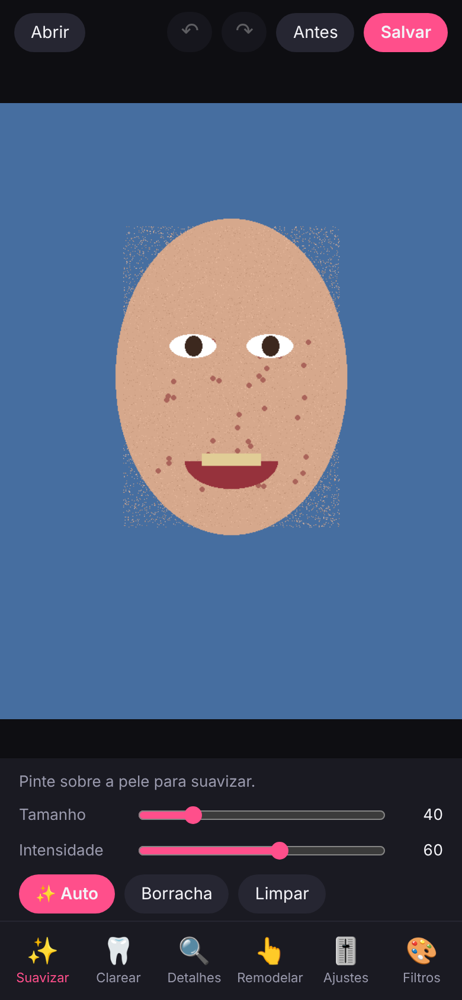
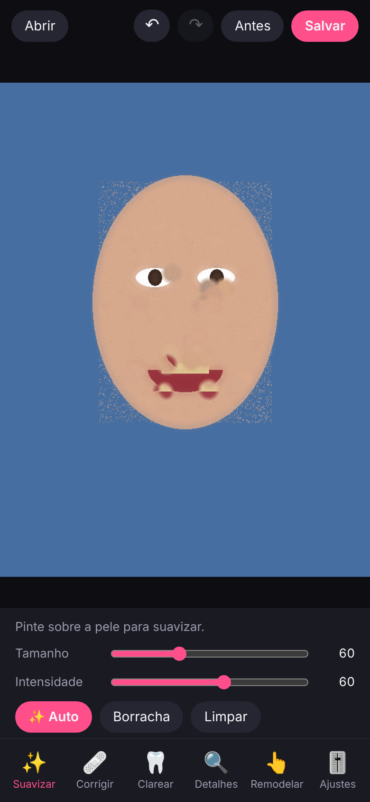

# FaceTune MVP

Editor de retratos **mobile-first** que roda no navegador, inspirado nas principais
funcionalidades do Facetune. Implementação *clean-room* — veja a especificação completa
(levantamento de funcionalidades, algoritmos, arquitetura) em [`docs/SPEC.md`](docs/SPEC.md).

| Antes | Depois (Corrigir + Auto) |
|---|---|
|  |  |

## Funcionalidades

- ✨ **Suavizar** — pincel de pele com blur que preserva bordas + botão **Auto** (detecta pele)
- 🩹 **Corrigir** — toque numa espinha/mancha para removê-la
- 🦷 **Clarear** — dentes e olhos
- 🔍 **Detalhes** — realça olhos, cabelo e textura
- 👆 **Remodelar** — arraste para empurrar traços (liquify)
- 🎚️ **Ajustes** — brilho, contraste, saturação, temperatura, vinheta
- 🎨 **Filtros** — Glow, Vívido, Vintage, Frio, P&B, Drama, com intensidade
- Borracha e "Limpar" por ferramenta, **Antes** (segure para comparar), desfazer/refazer (Ctrl+Z / Ctrl+Shift+Z), salvar em JPEG
- 100% local: nenhuma foto sai do dispositivo; sem modelos de IA para baixar

## Como rodar

```bash
npm install
npm run dev      # http://localhost:5173
npm test         # testes do motor de imagem
npm run build    # build de produção em dist/
```

Para testar no celular: `npm run dev -- --host` e abra o IP exibido na mesma rede Wi-Fi.

## Estrutura

```
src/main.ts      interface (DOM, toques, painéis)
src/core/        motor de imagem puro (sem DOM), testado com Vitest
tests/           testes unitários
docs/SPEC.md     especificação SPARC (requisitos, pseudocódigo, arquitetura, roadmap)
```

## Limitações do MVP

- Trabalha e exporta em até 1280 px no maior lado.
- Sem zoom com pinça e sem sliders de formato do rosto (dependem de landmarks faciais) — ver roadmap em `docs/SPEC.md`.
